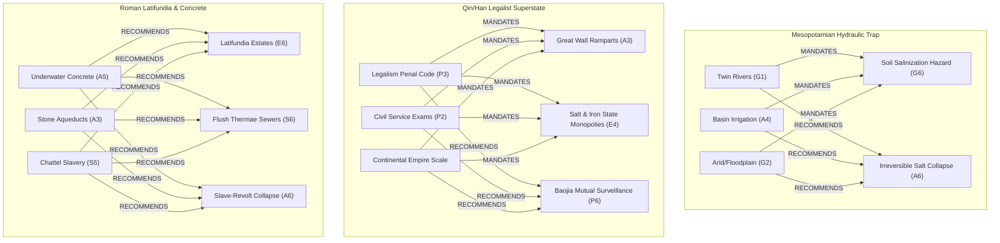

# G.R.A.P.E.S. Civilization Builder: Master Relationship & Interdependency Document (v4.2)

**Document Version:** 4.2.0  
**Target Architecture:** Multi-Variable Historical Logic Guard, Intelligent Synergy Engine & Grade-Level Complexity System  
**Repository Location:** `grapes-civilization-builder`  
**Live Production URL:** [https://grapes-civilization-builder.vercel.app](https://grapes-civilization-builder.vercel.app)

---

## 1. Executive Summary & Relational Philosophy

The **G.R.A.P.E.S. Civilization Builder** models human societies not as isolated lists of traits, but as **dynamically coupled socio-ecological systems**. Every choice a student makes in one category reverberates across all five other pillars:

```
                  ┌───────────────────────┐
                  │     GEOGRAPHY (G)     │
                  │   Terrain, Water,     │
                  │   Resources, Hazards  │
                  └───────────┬───────────┘
                             ╱ ╲
                            ╱   ╲
                           ╱     ╲
     ┌────────────────────▼─┐   ┌─▼────────────────────┐
     │     ECONOMY (E)      │   │     POLITICS (P)     │
     │ Crops, Animals,      │◄─►│ Government, Law,     │
     │ Trade, Currency, Tax │   │ Military, Diplomacy  │
     └──────────┬───────────┘   └──────────┬───────────┘
                │                          │
                │                          │
     ┌──────────▼───────────┐   ┌──────────▼───────────┐
     │ SOCIAL STRUCTURE (S) │   │     RELIGION (R)     │
     │ Apex, Middle, Mobility│◄─►│ Divine Structure,   │
     │ Gender, Labor Systems│   │ Rituals, Afterlife   │
     └──────────┬───────────┘   └──────────┬───────────┘
                 ╲                        ╱
                  ╲                      ╱
                   ╲                    ╱
                  ┌─▼──────────────────▼──┐
                  │    ACHIEVEMENTS (A)   │
                  │  Writing, Engineering,│
                  │  Monuments, Science   │
                  └───────────────────────┘
```

The relationship engine operates on two complementary mathematical and logical planes:
1. **The Logic Guard (`src/utils/logicRules.js`):** A **negative constraint matrix** enforcing historical realism, physical impossibility cutoffs, ecological carrying-capacity ceilings, chronological era locks, and institutional mutual exclusivities.
2. **The Synergy Engine (`src/utils/synergyRules.js`):** A **positive dependency network** that auto-links necessary material prerequisites (`mandatory`) and surfaces authentic cultural congruences (`recommended`) across single triggers and multi-variable compound cascades.

---

## 2. Hexagonal Domain Interdependency Topology

| Domain A | Domain B | Relational Dynamic & Historical Causality | Key Engine Invariants |
|---|---|---|---|
| **Geography (G)** | **Economy (E)** | Topography, freshwater regimes, and soil types dictate viable domesticates (wet rice vs. dry wheat vs. camel grazing). | Deserts preclude rice; tsetse fly zones preclude horses/cattle; volcanic islands require coconut/taro. |
| **Geography (G)** | **Politics (P)** | Open terrain enables cavalry expansion; jagged topography fosters defensible city-states; impassable borders shield isolationist kingdoms. | Steppe nomads live in mobile yurt camps; island thalassocracies rely on maritime war fleets. |
| **Geography (G)** | **Achievements (A)** | Available geological building materials limit architectural styles (mud-brick vs. limestone vs. volcanic basalt). | Pyramids require limestone/granite quarries; cuneiform requires alluvial river clay. |
| **Economy (E)** | **Social Structure (S)** | The mode of production determines social hierarchy (chattel slave plantations vs. communal ayllu clans vs. smallholder yeomanry). | Latifundia eliminate smallholders; commercial coin markets elevate merchant guilds. |
| **Economy (E)** | **Politics (P)** | State revenue extraction models define administrative depth and military doctrine. | Professional standing armies require currency or grain rations; barter cannot fund continental imperial armies. |
| **Politics (P)** | **Social Structure (S)** | State laws regulate social mobility, hereditary nobility, gender legal status, and unfree labor. | Democratic assemblies vote via ostracism; Spartan stratocracies subjugate helot serfs via the Krypteia police. |
| **Politics (P)** | **Religion (R)** | Sovereign legitimacy draws upon divine mandates, god-king ruler cults, or ecclesiastical concordats. | Egalitarian guild councils contradict living god-kings; legalist emperors burn dissenting philosophical scrolls. |
| **Religion (R)** | **Achievements (A)** | Eschatological afterlife beliefs and pantheon rituals drive monumental architecture and sacred scripts. | Imperial terracotta armies require subterranean necropolises; sacrificial bloodletting demands volcanic obsidian blades. |
| **Social Structure (S)**| **Achievements (A)** | Literacy access, scribal guilds, and specialized artisan classes govern scientific advancement. | Complex logographic scripts necessitate dedicated hereditary scribal castes (<2% literacy). |
| **Achievements (A)**| **Geography (G)** | Hydraulic mega-infrastructure alters landscapes, often triggering anthropogenic collapse vectors. | Over-irrigation causes alluvial salinization; plaster kilns cause hillside deforestation and karst aquifer exhaustion. |

---

## 3. Mutual Exclusivity Logic Matrix (`logicRules.js`)

The Logic Guard executes `checkOptionDisallowed()` across all 37 inquiries, cross-referencing active selections, the civilization's chronological era, and spatial territory scale.

### 3.1 Spatial Civilization Scale Constraints

```mermaid
graph TD
  CS["City-State (Local Valley/Polis)"]
  RK["Regional Kingdom (Unified River Valley)"]
  CE["Continental Empire (Multi-Biome Imperium)"]

  CS -->|Max 1 Terrain Biome| T1["Local Biome Only"]
  CS -->|Max 1 Freshwater Source| F1["Single Watercourse"]
  CS -->|Max 1 Natural Barrier| B1["Single Barrier"]
  CS -->|Max 1 Urban Morphology| U1["Acropolis or Port Town"]
  CS -.->|LOCKED| GW["Thousands of Miles of Frontier Walls"]
  CS -.->|LOCKED| MC["Hyper-Dense Megacity (500k+)"]

  RK -->|Max 2 Terrain Biomes| T2["Neighboring Biomes"]
  RK -->|Max 2 Natural Barriers| B2["Dual Frontiers"]
  RK -->|Max 2 Urban Morphologies| U2["Dual City Types"]

  CE -->|Unbounded Biomes| T3["Global Biomes"]
  CE -->|Max 3 Urban Morphologies| U3["Radial Imperial Network"]
  CE -.->|LOCKED| PB["Pure Village Barter / Wampum"]
  CE -.->|LOCKED| DD["Direct Town-Square Citizen Assembly"]
```



1. **City-State (`city_state`):**
   - **Terrain Limit:** Max 1 selection (`g2_terrain`).
   - **Freshwater Limit:** Max 1 selection (`g1_freshwater`).
   - **Natural Barrier Limit:** Max 1 selection (`g3_barriers`).
   - **Settlement Morphology Limit:** Max 1 selection (`g7_settlement`).
   - **Hard Prohibitions:** Cannot construct "Thousands of miles of frontier defensive walls" (`a3_monuments`) or house a "Hyper-Dense Walled Megacity Core" (`g7_settlement`).
2. **Regional Kingdom (`regional_kingdom`):**
   - **Terrain Limit:** Max 2 neighboring biomes (`g2_terrain`).
   - **Natural Barrier Limit:** Max 2 borders (`g3_barriers`).
   - **Settlement Morphology Limit:** Max 2 selections (`g7_settlement`).
3. **Continental Empire (`continental_empire`):**
   - **Terrain & Barriers:** Unbounded.
   - **Settlement Morphology Limit:** Max 3 selections (`g7_settlement`).
   - **Hard Prohibitions:** Cannot govern millions of subjects across continents via "Direct Participatory Democracy" (`p1_gov_system`). Cannot finance provincial administrative legions using "Pure Barter & Credit Tallies" or "Wampum Shell Belts" (`e3_currency`).

### 3.1.1 Tiered Selection Caps & Total Deprivation Guard

To prevent students from indiscriminately checking every shortage, disaster, or structural vector, strict mathematically calibrated selection caps are enforced:

- **Resource Shortages (`g5_shortages`):**
  - `basic` mode: Max **1** shortage.
  - `normal` mode: Max **2** shortages in `city_state` / `regional_kingdom`, Max **1** shortage in `continental_empire`.
  - `complex` mode: Max **3** in `city_state`, Max **2** in `regional_kingdom`, Max **1** in `continental_empire`.
  - **Total Deprivation Guard:** A civilization cannot simultaneously select all 3 foundational construction shortages: *"Lack of tall timber..."*, *"Lack of hard stone or metal ores..."*, and *"Lack of domestic clay deposits..."*. A society must possess wood, stone, OR clay to build shelter and storage vessels.
- **Environmental Disasters (`g6_disasters`):**
  - `basic` mode: Max **1** disaster.
  - `normal` & `complex` modes: Max **2** in `city_state`, Max **3** in `regional_kingdom` and `continental_empire`.
- **Anthropogenic Collapse Vectors (`a6_ecology_collapse`):**
  - Max **2** primary collapse vectors across all modes and scales.
- **Constitutional & Institutional Inquiry Caps (`normal` & `complex` modes):**
  - `e3_currency` (Medium of Exchange): Max **2** standards.
  - `p1_gov_system` (System of Government): Max **2** systems.
  - `p2_succession` (Transfer of Power): Max **2** mechanisms.
  - `p3_law_system` (Justice System): Max **2** philosophies.
  - `p5_foreign_policy` (Foreign Policy): Max **2** postures.
  - `s1_apex` (Ruling Apex Class): Max **2** classes.
  - `s3_mobility` (Social Mobility): Max **2** avenues.
  - `s4_gender` (Gender Legal Status): Max **1** framework (Max **2** in `continental_empire`).
  - `r1_structure` (Structure of Divine): Max **2** frameworks.
  - `r2_demeanor` (Cosmic Disposition): Max **2** dispositions.
  - `r4_afterlife` (Eschatology & Funerary): Max **2** doctrines.
  - `r5_gov_relation` (Religion & Government): Max **2** doctrines.

---

### 3.2 Chronological Era Locks (Historical Horizon Cutoffs)

Innovations cannot be selected prior to their genuine historical emergence:

| Innovation | Question ID | Earliest Valid Era | Cutoff Era (Blocked In) | Historical Justification Enforced |
|---|---|---|---|---|
| **High-grade iron smelting** | `g4_resources` | `early_iron` | Early/Late Bronze | Iron metallurgy was uninvented before ~1200 BCE; Bronze Age states used copper/tin. |
| **Phoenician phonetic alphabet** | `a1_writing` | `early_iron` | Early/Late Bronze | Pre-Iron Age writing was logographic (Hieroglyphs) or syllabic (Cuneiform). |
| **Disciplined crossbow phalanxes** | `p4_military` | `classical_antiquity` | Bronze & Early Iron | Bronze mechanical trigger locks were developed in Warring States China (~500 BCE). |
| **Standardized stamped coins** | `e3_currency` | `classical_antiquity` | Bronze & Early Iron | Stamped electrum/silver coins emerged in Lydia and Ionia (~600 BCE). |
| **Direct citizen assembly democracy** | `p1_gov_system` | `classical_antiquity` | Bronze & Early Iron | Universal male citizen suffrage was established in Cleisthenic Athens (~508 BCE). |
| **Cataphract Super-Heavy Shock Cavalry** | `p4_military` | `classical_antiquity` | Bronze & Early Iron | Full iron scale barding for horse and rider emerged with Parthians and Sarmatians (~300 BCE). |
| **Macedonian Pike & Companion Cavalry** | `p4_military` | `classical_antiquity` | Bronze & Early Iron | Philip II and Alexander pioneered the 18-ft sarissa combined-arms doctrine (~350 BCE). |
| **Inverted Siphons & Pressurized Pipelines** | `a4_hydraulic` | `classical_antiquity` | Bronze & Early Iron | Deep valley hydrostatic lead/ceramic siphons were Hellenistic and Roman feats (~300 BCE). |
| **Clay/Leather Promissory Notes & Flying-Cash** | `e3_currency` | `classical_antiquity` | Bronze & Early Iron | Paper/leather credit notes require advanced merchant banking and coin reserves (~200 BCE). |
| **Pozzolanic underwater concrete** | `a5_science` | `imperial_era` | All Pre-Imperial | Volcanic ash hydraulic marine concrete was developed in the late Roman Republic (~150 BCE). |
| **Magnetic lodestone compasses** | `a5_science` | `imperial_era` | All Pre-Imperial | Han Dynasty spoon compasses were unknown to Bronze and Classical builders (~200 BCE). |
| **Incendiary Naphtha / Greek Fire Siphons** | `p4_military` | `imperial_era` | All Pre-Imperial | Pressurized petroleum naval flamethrowers were Byzantine inventions (~670 CE). |

---

### 3.3 Strict Macroeconomic & Fiscal-Military Lockouts

```
   ┌──────────────────────────────────────────────┐
   │ p4: Permanent Professional Standing Army     │
   │ OR  Cataphract Super-Heavy Shock Cavalry     │
   └──────────────────────┬───────────────────────┘
                          │
                   MUTUAL LOCKOUT
             🔒 Fiscal-Military Lock
                          │
   ┌──────────────────────▼───────────────────────┐
   │ e3: Pure Barter & Credit Tallies             │
   │ (Full-time soldiers cannot be paid on barter)│
   └──────────────────────────────────────────────┘
```

1. **Professional Standing Army vs. Barter Economy:**
   - Selecting *Permanent Professional Standing Army* or *Cataphract Shock Cavalry* (`p4_military`) locks *Pure Barter & Credit Tallies* (`e3_currency`) and vice versa.
   - *Educational Logic:* Full-time specialized warriors who train year-round cannot eat social obligation tallies or barter cows; they require regular state pay in minted coinage, bullion weights, or guaranteed state granary rations.
2. **Continental Empire vs. Non-Standardized Currency:**
   - Setting scale to `continental_empire` locks *Pure Barter* and *Wampum Shell Belts* (`e3_currency`).
   - *Educational Logic:* A trans-continental state administering multi-lingual provinces cannot transport or calculate regional military budgets on shell beads or neighbor barter.
3. **Egalitarian Guild Council vs. Autocracy & Monumental Cults:**
   - Selecting *Egalitarian Civic Council of Merchant-Artisan Guilds* (`p1_gov_system`):
     - Locks: *Centralized Absolute Monarchy*, *Military Junta / Stratocracy*, *Feudal Bureaucracy* (`p1_gov_system`).
     - Locks: *The God-King and Royal Dynasty*, *Landowning Warrior Aristocracy* (`s1_apex`).
     - Locks: *Theocratic God-King Worship* (`r1_structure`).
     - Locks: *Rock-cut cliffside temples and royal mausoleums* (`a3_monuments`).
     - Locks: *Vast subterranean necropolises guarded by terracotta armies* (`r4_afterlife`).
   - *Educational Logic:* Harappan Indus-style egalitarian urbanism without royal palaces or military glorify-cults fundamentally excludes divine god-kings and gigantic imperial tombs.
4. **Nomadic Steppe Imperial Confederacy vs. Sedentary Mega-Infrastructure:**
   - Selecting *Nomadic Steppe Imperial Confederacy* (`p1_gov_system`) or *Mobile Seasonal Encampments / Ordu* (`g7_settlement`):
     - Locks: *Gravity-fed stone aqueducts, subterranean sewers, and public bathhouses* (`a3_monuments`).
     - Locks: *Planned grid-layout cities with standardized baked-brick houses* (`a3_monuments`).
     - Locks: *Artificial Enclosed Naval Harbors (Cothons)* (`a3_monuments`).
     - Locks: *Grand colonnaded temples with marble statues* (`a3_monuments`).
     - Locks: *Chinampas ("floating gardens")* (`a4_hydraulic`).
     - Locks: *Basin irrigation, dikes, and shadufs* (`a4_hydraulic`).
     - Locks: *Hyper-Dense Walled Megacity Core* (`g7_settlement`).
   - *Educational Logic:* Mobile pastoralist confederations living in portable felt yurts following seasonal grasslands do not build stationary stone sewers, grid cities, or naval drydocks.
5. **Tsetse Fly Trypanosomiasis Belt vs. Horses & Cattle:**
   - Selecting *Lack of draft-animal grazing pasture due to Tsetse fly trypanosomiasis belt* (`g5_shortages`):
     - Locks: *Horses and Camels*, *Oxen and Water Buffalo*, *Vast Herds of Sanga & Zebu Cattle*, *Donkeys and Mules* (`e2_animals`).
     - Locks: *Elite Chariot Corps*, *Horse Archer Light Cavalry*, *Cataphract Shock Cavalry*, *Macedonian Pike & Companion Cavalry* (`p4_military`).
   - *Educational Logic:* Tropical African tsetse flies transmit sleeping sickness (*trypanosomiasis*), which is lethal to equines and bovines, forcing reliance on human head-porterage and infantry warfare.

---

### 3.4 Complex-Tier Structural Contradictions (G7 – A6)

1. **Hyper-Dense Megacity (`g7_settlement`) Limitations:**
   - Cannot exist in a `city_state` (population exceeds carrying capacity of a single valley).
   - Cannot exist if food supply is exclusively *Pastoral Transhumance & Herd Grazing* (`e1_crops`).
   - Contradicts *Low-Density Dispersed Settlement & Clean Meltwater* (`s6_demographics_health`).
2. **Latifundia Slave Estates (`e6_property_land`) vs. Free Labor:**
   - Contradicts *Paid Free Laborers Only (no chattel slavery)* (`s5_unfree_labor`).
   - Contradicts *Equal-Field State Allotment System (Juntian)* (`e6_property_land`).
3. **Book Burning & Dissent Suppression (`r6_orthodoxy_heresy`) vs. Pluralism:**
   - Contradicts *Philosophical Academy Pluralism (Hundreds of Schools / Agora)* (`r6_orthodoxy_heresy`).
   - Contradicts *Pluralistic Edicts of Toleration (Cyrus Cylinder / Ashoka's Rock Edicts)* (`r6_orthodoxy_heresy`).
4. **Sustainable Regenerative Agro-Ecology (`a6_ecology_collapse`) vs. Collapse Vectors:**
   - Contradicts *Widespread Deforestation & Hillside Soil Erosion* (`a6_ecology_collapse`).
   - Contradicts *Irreversible Alluvial Soil Salinization* (`a6_ecology_collapse`).
   - Contradicts *Island Ecological Exhaustion & Palm Deforestation* (`a6_ecology_collapse`).

---

### 3.5 Climatic & Meteorological Mutual Exclusivities (G1/G2 vs. G6)

1. **Monsoon/Tropical/Desert vs. Sub-Zero Blizzards (Dzud):**
   - Tropical rainforests, arid deserts, river deltas, and monsoon basins strictly lock *Severe winter blizzards and permafrost frosts (dzud)* (`g6_disasters`) and vice versa.
   - *Reason:* Sub-zero permafrost blizzards cannot occur in equatorial rainforests or hyperthermic deserts.
2. **Monsoons, Typhoons & Tsunamis vs. Landlocked Biomes:**
   - *Monsoons, typhoons, or coastal tsunamis* (`g6_disasters`) cannot occur in landlocked high-altitude steppes, inland endorheic basins, or hyper-arid deserts.
3. **El Niño (ENSO) Ocean Deluge vs. Non-Pacific / Landlocked Biomes:**
   - *Sudden El Niño (ENSO) ocean temperature spikes* (`g6_disasters`) specifically impacts Pacific arid littoral coastlines (like Peru) and is prohibited in interior loess plateaus, endorheic basins, or sub-arctic taiga forests.
4. **Surface River Floods vs. Subterranean Water Regimes:**
   - *Catastrophic unannounced river floods* and *river course shifts* (`g6_disasters`) require large surface rivers; they cannot occur where freshwater is solely subterranean cenotes, artesian oasis springs, or coastal fog.
5. **Encroaching Desert Sand Dunes vs. Wet/Jungle/Taiga Biomes:**
   - *Encroaching desert sand dunes* (`g6_disasters`) cannot plague water-saturated tropical rainforests, wetland deltas, or sub-arctic taiga bogs.

---

### 3.6 Topographical & Border Geometry Mutual Exclusivities

1. **Inland Terrains vs. Maritime Infrastructure & Navies:**
   - A landlocked interior civilization with no coastline cannot deploy *Naval Supremacy (trireme fleets)* (`p4_military`), build *Artificial Enclosed Naval Harbors (Cothons)* (`a3_monuments`), establish *Maritime Merchant Thalassocracies* (`p1_gov_system`), or carve coastal *Megalithic Moai Statues* (`a3_monuments`).
2. **Open Ocean Isolation vs. Continental Terrains:**
   - *Uncharted offshore open ocean expanses* (`g3_barriers`) belongs exclusively to oceanic island archipelagos—not continental river plains or interior plateaus.
3. **No Surface Rivers vs. Riverine Infrastructure:**
   - Subterranean and spring regimes cannot construct *River Cataracts* (`g3_barriers`), *Riverine Barge Networks* (`e5_trade`), *River-Confluence Earthwork Mound Centers* (`g7_settlement`), or *Basin Irrigation Dikes* (`a4_hydraulic`).
4. **Flat Alluvial Plains vs. Mountain & Canyon Infrastructure:**
   - Flat alluvial floodplains and coral atolls cannot carve *Rock-Cut Cliffside Temples* (`a3_monuments`), construct *Cyclopean Hill Citadels* (`a3_monuments`), defend *Sandstone Slot Canyon Chokepoints (Siq)* (`g3_barriers`), or erect *Terraced Mountain Ridge-Citadels* (`g7_settlement`).
5. **Mangrove Swamps vs. Arid & Highland Terrains:**
   - *Impenetrable mangrove swamp flats* (`g3_barriers`) cannot border high-altitude alpine plateaus, hyper-arid desert basins, or frozen sub-arctic taiga.

---

### 3.7 Biological, Agricultural & Ecological Contradictions

1. **Sub-Arctic Boreal Taiga vs. Frost-Sensitive Crops & Animals:**
   - Sub-arctic taiga excludes frost-sensitive tropical crops (paddy rice, maize, sorghum, date palms, taro) and warm-climate beasts (camels, elephants, water buffalo).
2. **Cryophilic Fauna vs. Tropical/Desert Biomes:**
   - *Reindeer and Cold-Weather Steppe Ponies* (`e2_animals`) suffer fatal heat exhaustion in tropical rainforests, coral atolls, or hyperthermic deserts.
   - *Sturdy Steppe Ponies & Bactrian Camels* (`e2_animals`) cannot navigate dense equatorial rainforest jungles or oceanic coral atolls.
3. **Collapse Vector Prerequisites (`a6_ecology_collapse`):**
   - *Island Ecological Exhaustion* requires an oceanic island or archipelago ecosystem.
   - *Steppe Overgrazing & Desertification* requires large domesticated grazing herds or pastoral transhumance.
   - *Irreversible Alluvial Soil Salinization* requires intensive canal, basin, or subterranean irrigation networks.
   - *Slave-Revolt & Latifundia Hollowing* requires extensive chattel slavery, debt serfdom, or state-owned helot castes.
4. **Metallurgical Poisoning Prerequisite:**
   - *Endemic Lead/Mercury Poisoning* (`s6_demographics_health`) requires advanced metal smelting, pipes, and cinnabar, and is impossible in societies with critical metal shortages or non-metallurgical coral atolls.

---

### 3.8 Geological, Resource & Shortage Cascade Lockouts (v4.2)

1. **Marine Murex Sea Snails vs. Landlocked Biomes:**
   - Harvesting *Marine murex sea snails* (`g4_resources`) for Tyrian purple dye requires ocean waters and is locked if the civilization is landlocked.
2. **Volcanic Obsidian & Basalt vs. Sediment Mud:**
   - *Obsidian* and *Basalt/andesite* (`g4_resources`) require volcanic formations or mountains, and are prohibited in pure alluvial floodplains and marsh deltas.
3. **Baltic Amber, Bog Iron & Sub-Arctic Furs vs. Hot/Tropical Biomes:**
   - *Baltic amber, bog iron, and sub-arctic fur pelts* (`g4_resources`) form exclusively in cold northern taiga or highland steppes/mountains, not in tropical jungles or arid deserts.
4. **Wild Silk & Mulberry Groves vs. Freezing/Arid Biomes & Fiber Shortages:**
   - *Wild silk cocoons and white mulberry groves* (`g4_resources`) require temperate/subtropical river valleys and cannot exist in freezing taiga, hyper-arid deserts, or under a textile fiber shortage.
5. **Textile Fiber Shortage Cascades:**
   - *Lack of textile plant fibers or sheep wool* (`g5_shortages`) locks cotton/flax crops, wool sheep/alpacas, silk currency bolts, and master textile guilds.
6. **Clay Shortage Cascades:**
   - *Lack of domestic clay deposits* (`g5_shortages`) locks clay writing tablets, recycled ostraca, clay merchant envelope bullae, terracotta armies, baked-brick grid cities, and glazed ceramic brick friezes.
7. **Arable Farmland Shortage Cascades:**
   - *Lack of arable farmland* (`g5_shortages`) locks wheat/rice staples, state grain-redistribution currency, agricultural crop tithes, and state famine granaries.
8. **Fuel Firewood & Charcoal Shortage Cascades:**
   - *Lack of fuel firewood and charcoal* (`g5_shortages`) locks dense timber forests, kiln-baked brick cities, and kiln/smelter deforestation collapse vectors.

---

### 3.9 Writing Script & Medium Ecological / Biological Locks (v4.2)

1. **Parchment / Vellum vs. Zero Domesticated Livestock:**
   - *Parchment or vellum* (`a2_medium`) is made from sheep/calf/goat hides; societies without domesticated animals cannot produce animal parchment.
2. **Palm-Leaf Manuscripts & Bark-Paper Codices vs. Treeless / Freezing Biomes:**
   - *Bark paper (amatl)* and *palm-leaf manuscripts* (`a2_medium`) require tropical or oasis trees and cannot be produced in freezing steppes, taiga, or timber-starved biomes.
3. **Papyrus Scrolls vs. Cold / Highland / Rainforest Biomes:**
   - *Papyrus scrolls* (`a2_medium`) require warm marshlands (like the Nile) and rot rapidly in humid tropical rainforests or freezing climates.
4. **Cast Bronze Ritual Inscriptions vs. Metal / Fuel Shortages:**
   - Inscribed bronze ritual vessels require copper, tin fluxes, and charcoal blast furnaces; they are locked if metal, tin, or fuel is critically scarce.

---

### 3.10 Political, Juridical, Theological & Surveillance Lockouts (v4.2)

1. **Pure Theocracy vs. Secular / Democratic / Guild Governance:**
   - *Pure Theocracy* (`r5_gov_relation`) vests supreme authority in the High Priest and excludes direct democracy, merchant guild councils, or elected civic priests.
2. **Distant / Indifferent Gods & Karmic Monism vs. Interventionist Rites:**
   - If the gods are *distant and indifferent* or the cosmos operates on automatic *karmic self-causation* (`r2_demeanor`), the divine will not intervene in river trials by ordeal, answer oracle lot urns, or demand human blood sacrifices.
3. **Iconoclastic Monotheism vs. Syncretism & Pluralism:**
   - *Strict Iconoclastic Exclusivism* (`r6_orthodoxy_heresy`) prohibits imperial pantheon syncretism and edicts of religious toleration. Conversely, *Pluralistic Toleration* excludes book burning, total enslavement, and mass deportation.
4. **State / Clan Land Monopoly vs. Private Real Estate:**
   - If 100% of farmland is inalienable *Royal/Temple Domain* or *Communal Ayllu* trust (`e6_property_land`), private citizens cannot buy, mortgage, or accumulate private slave latifundia, and private merchant oligarchs cannot dominate society.
5. **Intelligence & Surveillance Infrastructure Consistency:**
   - *Imperial Courier Relay Highways* (`p6_intelligence_bureaucracy`) require territorial scale beyond a city-state and draft/pack horses.
   - *Quipu Statistical Audits* require quipu knotted cords (`a1_writing`).
   - *Diplomatic Cuneiform Archives* cannot function under isolationist foreign policies or non-written record systems.
   - *Citizen Ostracism* requires democratic citizen assemblies or aristocratic republican councils.
6. **Military Supply Realism:**
   - Bronze phalanxes and crossbow formations require metal ores; war elephant corps require domesticated elephants; companion cavalry with 18-foot sarissas requires warhorses and tall timber.

---

---

## 4. Single-Trigger Pair Synergy Network (`LOGICAL_SYNERGIES`)

The master synergy registry maps **74 pairwise historical dependencies**. When a foundational choice is selected, it triggers either a `mandatory` auto-link or a `recommended` glowing badge.

### Complete Pair Synergy Mapping Table

| # | Trigger Option (Source) | Target Inquiry | Cascaded Option | Synergy Type | Historical Rationalization |
|---|---|---|---|---|---|
| 1 | **Nile Annual Flooding** (`g1`) | `a4_hydraulic` | Basin irrigation, dikes, and shadufs | `mandatory` | Floodwater retention basins require earthen dikes. |
| 2 | **Nile Annual Flooding** (`g1`) | `g4_resources` | Rich alluvial clay and mud | `mandatory` | River silt supplies clay for bricks and pottery. |
| 3 | **Underground Cenotes** (`g1`) | `g4_resources` | Quarried limestone, granite, or marble | `mandatory` | Cenotes form in karst limestone plateaus. |
| 4 | **Glacial Mountain Meltwater** (`g1`) | `g2_terrain` | Steep, jagged mountain ranges | `mandatory` | Glacial meltwater originates in high alpine peaks. |
| 5 | **Glacial Mountain Meltwater** (`g1`) | `a4_hydraulic` | Mountain terrace farming | `mandatory` | Rapid downhill runoff requires retaining terraces. |
| 6 | **Monsoon Rains** (`g1`) | `a4_hydraulic` | Stepwells and Massive Sunken Reservoirs | `mandatory` | Seasonal rain demands deep dry-season storage tanks. |
| 7 | **Desert Flash-Flood Wadis** (`g1`) | `a4_hydraulic` | Check-dams and rock terracing | `mandatory` | Flash floods must be trapped behind stone check-dams. |
| 8 | **Huang He Loess River** (`g1`) | `g6_disasters` | Rapid silting and course shifts | `recommended` | Heavy silt triggers catastrophic levee breaches. |
| 9 | **Huang He Loess River** (`g1`) | `p2_succession`| Mandate of Heaven / Dynastic Cycle | `recommended` | River floods were read as celestial loss of mandate. |
| 10 | **Steep Mountain Ranges** (`g2`) | `a4_hydraulic` | Mountain terrace farming | `mandatory` | Vertical topography requires flat carved benches. |
| 11 | **Steep Mountain Ranges** (`g2`) | `g3_barriers` | Impassable, freezing mountain ranges | `mandatory` | Mountains serve as natural defensive barriers. |
| 12 | **Rocky Greek Peninsula** (`g2`) | `e5_trade` | Maritime Trade Empire | `mandatory` | Mountainous terrain forces populations to sea lanes. |
| 13 | **Rocky Greek Peninsula** (`g2`) | `g3_barriers` | Treacherous rocky coastlines and reefs | `mandatory` | Jagged coastlines provide maritime protection. |
| 14 | **Peruvian Fog Oasis** (`g2`) | `g6_disasters` | El Niño (ENSO) ocean spikes & deluge | `recommended` | Coastal upwelling shifts cause catastrophic rains. |
| 15 | **Peruvian Fog Oasis** (`g2`) | `e1_crops` | Cotton and Flax / Linseed | `recommended` | Coastal fishing cultures require cotton for nets. |
| 16 | **Polynesian High Islands** (`g2`)| `g1_freshwater`| Basalt island freshwater lenses | `mandatory` | Isolated atolls depend on volcanic crater lenses. |
| 17 | **Cuneiform Script** (`a1`) | `a2_medium` | Baked or sun-dried clay tablets | `mandatory` | Reed styluses require soft river clay tablets. |
| 18 | **Cuneiform Script** (`a1`) | `g4_resources` | Rich alluvial clay and mud | `mandatory` | Mud-brick civilizations extract clay for tablets. |
| 19 | **Cuneiform Script** (`a1`) | `s2_middle` | Scribes and Record-Keepers | `mandatory` | Hundreds of cuneiform signs mandate scribe guilds. |
| 20 | **Egyptian Hieroglyphs** (`a1`) | `a2_medium` | Papyrus scrolls from pressed reeds | `recommended` | Hieroglyphs and cursive hieratic suited papyrus. |
| 21 | **Egyptian Hieroglyphs** (`a1`) | `g4_resources` | Papyrus reeds, bamboo, or marsh plants | `recommended` | Papyrus marsh plant harvest along rivers. |
| 22 | **Egyptian Hieroglyphs** (`a1`) | `s2_middle` | Scribes and Record-Keepers | `mandatory` | Sacred script requires elite scribal training. |
| 23 | **Quipu Knotted Cords** (`a1`) | `e2_animals` | Llamas and Alpacas | `mandatory` | Quipus were manufactured from dyed alpaca wool. |
| 24 | **Quipu Knotted Cords** (`a1`) | `e1_crops` | Freeze-dried Potatoes & Quinoa | `mandatory` | Andean highland tuber economy recorded on quipus. |
| 25 | **Mesoamerican Bark Codices** (`a1`)| `a2_medium` | Accordion-folded bark paper (amatl) | `mandatory` | Pictographs painted on lime-plastered fig bark. |
| 26 | **Shang Cast Bronze Inscriptions** (`a1`)| `g4_resources`| Copper and tin deposits | `mandatory` | Smelting ritual cauldrons requires copper and tin. |
| 27 | **Shang Cast Bronze Inscriptions** (`a1`)| `r1_structure`| Ancestor Veneration & Harmony | `recommended` | Bronze vessels dedicated to ancestral sacrifices. |
| 28 | **Elite Chariot Corps** (`p4`) | `e2_animals` | Horses and Camels | `mandatory` | War chariots require domesticated draft horses. |
| 29 | **Horse Archer Light Cavalry** (`p4`)| `e2_animals` | Horses and Camels | `mandatory` | Steppe skirmishers require hardy steppe ponies. |
| 30 | **War Elephant Corps** (`p4`) | `e2_animals` | Asian War Elephants & Work Elephants | `mandatory` | Battlefield shock units require elephant stocks. |
| 31 | **Trireme Naval Supremacy** (`p4`) | `g4_resources` | Dense cedar, oak, or mahogany forests | `mandatory` | Hull framing and oars require massive timber. |
| 32 | **Trireme Naval Supremacy** (`p4`) | `e5_trade` | Maritime Trade Empire | `mandatory` | Fleets protect commercial sea lanes and colonies. |
| 33 | **Disciplined Crossbow Phalanxes** (`p4`)| `a5_science`| Interchangeable Bronze Parts & Crossbows | `mandatory` | Standardized bronze trigger locks for volleys. |
| 34 | **Siege Warfare Specialists** (`p4`)| `g4_resources` | Dense cedar, oak, or mahogany forests | `mandatory` | Battering rams and siege towers require lumber. |
| 35 | **Outrigger War Canoes** (`p4`) | `a5_science` | Catamaran Engineering & Crab-Claw Sails | `mandatory` | Island warfare demands open-sea catamaran designs. |
| 36 | **Outrigger War Canoes** (`p4`) | `p3_law_system`| Sacred Kapu / Tapu Taboo Code | `recommended` | Maritime expeditions regulated by priestly taboos. |
| 37 | **Chinampas Floating Gardens** (`a4`)| `g1_freshwater`| Tropical crater caldera lakes & marshes | `mandatory` | Chinampas require shallow freshwater lakebeds. |
| 38 | **Chinampas Floating Gardens** (`a4`)| `e1_crops` | Maize, Beans, and Squash (Three Sisters)| `mandatory` | High-yield chinampas grew symbiotic staple polycultures. |
| 39 | **Aksumite Dzimbahwe Enclosures** (`a3`)| `g4_resources` | Quarried limestone, granite, or marble | `mandatory` | Mortarless stone enclosures require granite rocks. |
| 40 | **Aksumite Dzimbahwe Enclosures** (`a3`)| `e2_animals` | Vast Herds of Sanga & Zebu Cattle | `recommended` | Pastoral cattle wealth funded stone stelae. |
| 41 | **Trans-Saharan Gold-Salt Trade** (`e5`)| `e2_animals` | Domesticated Dromedary & Bactrian Camels | `mandatory` | Crossing desert sand seas requires camels. |
| 42 | **Trans-Saharan Gold-Salt Trade** (`e5`)| `g4_resources` | Vast rock salt domes & salterns | `mandatory` | Desert salt blocks exchanged for savannah gold. |
| 43 | **Andean Vertical Archipelago** (`e5`)| `g2_terrain` | Steep, jagged mountain ranges | `mandatory` | Vertical tiers exist across steep mountain slopes. |
| 44 | **Andean Vertical Archipelago** (`e5`)| `e4_taxation` | Reciprocal Mit'a Labor Service | `recommended` | State caravans link ecological production zones. |
| 45 | **Monsoon Dhow Trade** (`e5`) | `a5_science` | Lateen Sails & Swell Navigation | `mandatory` | Triangular lateen sails permit sailing into monsoon winds. |
| 46 | **Silk Road Oasis Caravans** (`e5`)| `e2_animals` | Domesticated Dromedary & Bactrian Camels | `mandatory` | Desert road transport via two-humped Bactrian camels. |
| 47 | **Silk Road Oasis Caravans** (`e5`)| `a5_science` | Silk cultivation & glassblowing | `recommended` | High-value luxury textiles drive overland trade. |
| 48 | **Harappan Standardized Seals** (`e3`)| `a3_monuments` | Planned grid-layout cities with drains | `recommended` | Standardized weights/measures match Indus grid cities. |
| 49 | **Harappan Standardized Seals** (`e3`)| `e3_currency` | Steatite Inscribed Merchant Seals | `recommended` | Clay envelope tokens certify merchant transactions. |
| 50 | **Terracotta Army Necropolises** (`r4`)| `g4_resources` | Rich alluvial clay and mud | `mandatory` | Molding 8,000 soldiers requires immense ceramic clay. |
| 51 | **Terracotta Army Necropolises** (`r4`)| `p1_gov_system`| Centralized Absolute Monarchy | `recommended` | Mobilizing state necropolises requires imperial power. |
| 52 | **Oracle Bone Divination** (`r3`) | `a1_writing` | Logographic Script (characters) | `recommended` | Early Chinese script evolved on turtle plastrons. |
| 53 | **Oracle Bone Divination** (`r3`) | `s1_apex` | Sacred Shaman-Kings and Astrologers | `recommended` | Divination monopoly cemented royal political authority. |
| 54 | **Matrilineal Succession (Kandake)** (`p2`)| `s4_gender` | Dual-Sex Governance & Female Co-Rulers | `recommended` | Kushite Kandakes ruled jointly with warrior kings. |
| 55 | **Matrilineal Succession (Kandake)** (`p2`)| `s1_apex` | Matriarchal Clan Mothers | `recommended` | Clan mothers confirm royal dynastic lines. |
| 56 | **Nomadic Steppe Imperial Confederacy** (`p1`)| `e1_crops` | Pastoral Transhumance & Herd Grazing | `mandatory` | Steppe empire based on kumis, cheese, and meat. |
| 57 | **Nomadic Steppe Imperial Confederacy** (`p1`)| `p4_military`| Horse Archer Light Cavalry | `mandatory` | Every pastoralist was a horse-mounted archer. |
| 58 | **Nomadic Steppe Imperial Confederacy** (`p1`)| `r4_afterlife`| Royal Kurgan Burial Mounds | `recommended` | Kurgan mounds filled with horse sacrifices. |
| 59 | **Outrigger Catamarans** (`a5`) | `a1_writing` | Marshallese Stick Charts & Songlines | `mandatory` | Wave-piloting swell refraction recorded on stick charts. |
| 60 | **Hyper-Dense Megacity** (`g7`) | `s6_health` | Zoonotic Crowd-Disease Endemicity | `mandatory` | High density breeds endemic smallpox/measles immunity. |
| 61 | **Hyper-Dense Megacity** (`g7`) | `s6_health` | Ever-Normal Famine Granaries | `recommended` | Megacities collapse without state grain price buffers. |
| 62 | **Tropical Garden Urbanism** (`g7`) | `g2_terrain` | Dense tropical rainforest | `mandatory` | Dispersed temple agro-cities form in jungle canopies. |
| 63 | **Tropical Garden Urbanism** (`g7`) | `a6_ecology` | Monoculture & Aquifer Collapse | `recommended` | Jungle limestone soils vulnerable to drought. |
| 64 | **Mobile Steppe Ordu** (`g7`) | `p1_gov_system`| Nomadic Steppe Imperial Confederacy | `mandatory` | Wagon cities require khaganate clan assembly. |
| 65 | **Mobile Steppe Ordu** (`g7`) | `e1_crops` | Pastoral Transhumance & Herd Grazing | `mandatory` | Moving camps follow seasonal animal pastures. |
| 66 | **Latifundia Slave Estates** (`e6`)| `s5_labor` | Prisoners of War & Chattel Slavery | `mandatory` | Latifundia worked by chained war captives. |
| 67 | **Latifundia Slave Estates** (`e6`)| `a6_ecology` | Slave-Revolt & Latifundia Hollowing | `recommended` | Free citizen recruiting pool replaced by slaves. |
| 68 | **Equal-Field System (Juntian)** (`e6`)| `p6_intel` | Baojia Mutual Household Surveillance | `recommended` | Periodic redistribution requires census registration. |
| 69 | **Equal-Field System (Juntian)** (`e6`)| `s2_middle` | Free Smallholder Farmers | `recommended` | Yeoman peasant households form the tax backbone. |
| 70 | **Communal Ayllu Landholding** (`e6`)| `e4_taxation` | Reciprocal Mit'a Labor Service | `mandatory` | Clan land worked in communal rotation for state feasts. |
| 71 | **Communal Ayllu Landholding** (`e6`)| `p6_intel` | Quipu Statistical Census Ledgers | `recommended` | Clan grain storage tracked by Chasqui quipus. |
| 72 | **Military Cleruchy Grants** (`e6`)| `p4_military` | Permanent Professional Standing Army | `mandatory` | Conquered land given to veterans for military service. |
| 73 | **Military Cleruchy Grants** (`e6`)| `s3_mobility` | Military Valor Nobility Grants | `recommended` | Battlefield bravery rewarded with landed estates. |
| 74 | **Imperial Post Highway Spies** (`p6`)| `p5_foreign` | Satrapy Provincial Administration | `mandatory` | King's Eyes and Ears spy on distant satraps. |
| 75 | **Sub-Arctic Boreal Taiga** (`g2`) | `g4_resources` | Baltic amber, bog iron, dense furs | `mandatory` | Northern conifer forests yield resin and furs. |
| 76 | **Sub-Arctic Boreal Taiga** (`g2`) | `e1_crops` | Rye, Oats, and Cold-Hardy Hemp | `mandatory` | Short frost-prone northern growing seasons. |
| 77 | **Endorheic Inland Basin** (`g2`) | `a4_hydraulic` | Qanats / Subterranean Foggara | `mandatory` | Snow-fed piedmont aquifers channeled beneath sand. |
| 78 | **Fossil Artesian Springs** (`g1`) | `e1_crops` | Date Palms and Oasis Figs | `mandatory` | Deep depression springs sustain oasis date groves. |
| 79 | **Desert Flash-Flood Wadis** (`g1`) | `a3_monuments` | Rock-Cut Cliffside Temples (Petra) | `recommended` | Canyon sandstone walls carved into mausoleums. |
| 80 | **Fertile Caldera Valleys** (`g2`) | `g1_freshwater`| Crater caldera lakes & lagoons | `mandatory` | Volcanic calderas trap rainfall in alpine lakes. |
| 81 | **Alluvial Gold & Frankincense** (`g4`)| `r3_rituals` | Daily food, wine, and incense offerings| `recommended` | Exotic resins burned in temple sanctuary censers. |
| 82 | **Cinnabar & Porcelain Clay** (`g4`)| `s6_health` | Endemic Lead/Mercury Poisoning | `recommended` | Toxic mercury sulfide fumes and alchemical elixirs. |
| 83 | **Chartered Merchant Karums** (`e5`)| `e3_currency` | Weighed Metal Bullion & Silver Rings | `mandatory` | Extraterritorial merchant colonies trade in silver weight. |
| 84 | **Mamluk / Janissary Soldiers** (`s5`)| `p4_military` | Permanent Professional Standing Army | `mandatory` | Enslaved captive youths trained as standing corps. |
| 85 | **Royal & Temple Domain Monopoly** (`e6`)| `e3_currency` | State Grain Redistribution | `mandatory` | Palace/temple leases paid in redistributive grain. |
| 86 | **Private Freehold Yeomanry** (`e6`)| `s2_middle` | Free Smallholder Farmers | `mandatory` | Smallholder farmers form the yeoman citizen core. |
| 87 | **Debt-Bondage Sharecropping** (`e6`)| `s5_unfree_labor` | Temporary Debt Bondage | `mandatory` | Tenant sharecroppers fall into debt peonage. |
| 88 | **Sacred Ecological Commons** (`e6`)| `p3_law_system` | Sacred Kapu / Tapu Taboo Code | `mandatory` | Communal lagoons/forests regulated by chief taboos. |
| 89 | **Amarna Cuneiform Brotherhood** (`p6`)| `a1_writing` | Cuneiform script on baked clay | `mandatory` | Diplomatic lingua franca letters on clay tablets. |
| 90 | **Maritime Harbor Espionage** (`p6`)| `e5_trade` | Maritime Trade Empire | `mandatory` | Commercial harbor consuls track competitor navies. |
| 91 | **Imperial Pantheon Syncretism** (`r6`)| `r1_structure` | Anthropomorphic Polytheism | `mandatory` | Foreign deities matched with imperial pantheon gods. |
| 92 | **Imperial Ruler Cult Sacrifices** (`r6`)| `r5_gov_relation` | Imperial Pontificate | `mandatory` | Incense sacrifice to emperor requires imperial high priest. |
| 93 | **Caesaro-Papism Ecumenical Councils** (`r5`)| `p1_gov_system` | Centralized Absolute Monarchy | `mandatory` | Enforcing uniform dogma requires autocratic monarchy. |
| 94 | **Dual-Crown Diarchy** (`r5`)| `p1_gov_system` | Diarchy (two co-equal kings) | `mandatory` | Sacred taboo king paired with secular war king. |
| 95 | **Porphyrogeniture ('Born in Purple')** (`p2`)| `s1_apex` | The God-King and Royal Dynasty | `mandatory` | Succession restricted to divine palace-born bloodline. |
| 96 | **Incendiary Greek Fire Siphons** (`p4`)| `g4_resources` | Natural bitumen and surface asphalt | `mandatory` | Naval flame siphons require petroleum bitumen seeps. |

---

## 5. The 17 Multi-Trigger Compound Cascades

Compound synergies trigger when **multiple foundational variables coincide**, modeling complex historical civilizational paradigms:



### 1. Mesoamerican Sacrificial & Obsidian Complex (`bloodletting_obsidian_complex`)
- **Triggers:** Ritual bloodletting / human sacrifice (`r3_rituals`) + High-grade volcanic obsidian deposits (`g4_resources`).
- **Cascaded Effects:**
  - Auto-recommends *Ritual War Captives* (`s5_unfree_labor`).
  - Auto-recommends *Ritual Athletic & Sacrificial Prowess* (`s3_mobility`).
- **Historiography:** Mesoamerican Aztec and Classic Maya civilizations leveraged razor-sharp prismatic obsidian blades for high-priest bloodletting and coronary excision, capturing enemy warriors in flower-wars for temple consecration.

### 2. Continental Imperial Satrapy Administration (`satrapy_continental_empire`)
- **Triggers:** Continental Empire scale (`currentScale === 'continental_empire'`) + Satrapy Provincial Administration (`p5_foreign_policy`) + Iron Age or later.
- **Cascaded Effects:**
  - Auto-recommends *Kharosthi and Aramaic Administrative Cursive* (`a1_writing`).
  - Auto-recommends *Tribute from Conquered Provinces* (`e4_taxation`).
- **Historiography:** The Achaemenid Persian Empire administered 20+ multinational satrapies along the Royal Road from Sardis to Susa, utilizing Official Imperial Aramaic on parchment for bilingual edicts.

### 3. Oceanic Wayfinding & High Island Agriculture (`ocean_voyaging_agriculture`)
- **Triggers:** Uncharted open ocean barrier (`g3_barriers`) + Taro, yams, and breadfruit staples (`e1_crops`).
- **Cascaded Effects:**
  - **Mandates** *Celestial Navigation & Swell Piloting* (`a5_science`).
  - **Mandates** *Naval Navigators and Master Shipwrights Guild* (`s2_middle`).
- **Historiography:** Polynesian voyagers navigated across the Polynesian Triangle using star paths, ocean swell refraction, and bird migrations in double-hulled catamarans with vegetative cargo.

### 4. Mesopotamian Hydraulic & Salinization Trap (`mesopotamia_salinization_complex`)
- **Triggers:** Violent, unpredictable twin rivers (`g1_freshwater`) + Basin irrigation, dikes, and shadufs (`a4_hydraulic`) + Arid desert or alluvial floodplains (`g2_terrain`).
- **Cascaded Effects:**
  - **Mandates** *Soil salinization hazard* (`g6_disasters`).
  - Auto-recommends *Irreversible Alluvial Soil Salinization* (`a6_ecology_collapse`).
- **Historiography:** In southern Sumerian Mesopotamia, centuries of furrow irrigation under scorching desert sun caused water tables to rise, evaporating and depositing toxic sodium crusts that forced a collapse from wheat to salt-tolerant barley, and eventual demographic collapse.

### 5. Qin/Han Legalist-Bureaucratic Superstate (`qin_han_legalist_complex`)
- **Triggers:** Legalism collective punishment (`p3_law_system`) + Civil service merit exams (`p2_succession`) + Continental Empire scale.
- **Cascaded Effects:**
  - **Mandates** *Thousands of miles of frontier walls* (`a3_monuments`).
  - **Mandates** *State Monopolies on Salt and Iron* (`e4_taxation`).
  - Auto-recommends *Household Registration & Mutual Surveillance Groups (Baojia)* (`p6_intelligence_bureaucracy`).
- **Historiography:** Shang Yang and Qin Shi Huang unified China by destroying aristocratic fiefdoms, instituting 5-family mutual responsibility groups, state control of iron/salt furnaces, and conscripting peasantry for the Great Wall.

### 6. Roman Imperial Latifundia & Concrete Complex (`roman_imperial_complex`)
- **Triggers:** Concrete that sets underwater (`a5_science`) + Gravity-fed stone aqueducts (`a3_monuments`) + Chattel slavery (`s5_unfree_labor`).
- **Cascaded Effects:**
  - Auto-recommends *Latifundia / Aristocratic Slave Estates* (`e6_property_land`).
  - Auto-recommends *Municipal Hydraulic Flush Sewers & Thermae* (`s6_demographics_health`).
  - Auto-recommends *Slave-Revolt & Latifundia Hollowing* (`a6_ecology_collapse`).
- **Historiography:** Roman Mediterranean hegemony paired monumental hydraulic engineering (*pozzolana* concrete, Cloaca Maxima, Pont du Gard) with large-scale aristocratic olive/wheat plantations worked by enslaved captives, displacing the citizen-soldier peasant class and fueling the Servile Wars.

### 7. Andean Mit'a & Vertical Archipelago State (`inca_andean_complex`)
- **Triggers:** Quipu knotted cords (`a1_writing`) + Suspension rope bridges (`a4_hydraulic`) + Steep jagged mountains (`g2_terrain`).
- **Cascaded Effects:**
  - **Mandates** *Vertical Archipelago Exchange* (`e5_trade`).
  - **Mandates** *Reciprocal Mit'a Labor Service* (`e4_taxation`).
  - **Mandates** *State Grain Redistribution (no money)* (`e3_currency`).
- **Historiography:** The Incan Tawantinsuyu spanned vertical microclimates across the Andes. Without written text, draft horses, or coined money, the state organized rotational labor brigades (*mit'a*) via quipu accounting and rope bridges to store freeze-dried potatoes in imperial granaries (*qullqas*).

### 8. Steppe Nomadic Kurgan & Cavalry Hegemony (`steppe_nomad_complex`)
- **Triggers:** High-altitude flat steppe (`g2_terrain`) + Horse archer light cavalry (`p4_military`) + Pastoral transhumance (`e1_crops`).
- **Cascaded Effects:**
  - **Mandates** *Tanistry / Kurultai Council* (`p2_succession`).
  - **Mandates** *Royal Kurgan Burial Mounds* (`r4_afterlife`).
  - **Mandates** *Severe winter blizzards (dzud)* (`g6_disasters`).
- **Historiography:** Eurasian Scythians, Xiongnu, and Mongols operated as horse-mounted pastoralists. Succession required battlefield demonstration confirmed by the clan assembly (*Kurultai*), interring chieftain dynasties in earthen kurgan mounds filled with horse gear and animal-style gold.

### 9. Sub-Saharan African Iron-Cattle-Monsoon Complex (`afro_indian_ocean_complex`)
- **Triggers:** Highland savanna plateaus (`g2_terrain`) + Sorghum/yams/teff staples (`e1_crops`) + High-grade iron ore (`g4_resources`).
- **Cascaded Effects:**
  - Auto-recommends *Vast Herds of Sanga & Zebu Cattle* (`e2_animals`).
  - Auto-recommends *Mortarless Granite Enclosures & Obelisks* (`a3_monuments`).
  - Auto-recommends *Monsoon Indian Ocean Dhow Trade* (`e5_trade`).
- **Historiography:** The Kingdom of Aksum and Great Zimbabwe civilization synthesized iron smelting, high-altitude cattle pastoralism, and stone architecture, channeling gold, ivory, and frankincense into biannual Indian Ocean dhow navigation routes.

### 10. Athenian Maritime Democracy & Silver Complex (`athens_thalassocracy_complex`)
- **Triggers:** Direct participatory democracy (`p1_gov_system`) + Trireme naval supremacy (`p4_military`) + Standardized stamped coins (`e3_currency`).
- **Cascaded Effects:**
  - Auto-recommends *Liturgical Wealth Sponsorship (Chorēgia / Trierarchy)* (`e4_taxation`).
  - Auto-recommends *Citizen Ostracism & Public Informer Courts* (`p6_intelligence_bureaucracy`).
  - Auto-recommends *Philosophical Academy Pluralism* (`r6_orthodoxy_heresy`).
- **Historiography:** Classical Athens funded its wooden wall of triremes through Laurion state silver mines and mandatory wealth liturgies on the wealthy, empowering landless rowers (*thetes*) with assembly voting rights, protected from aspiring tyrants via pottery shard ostracism.

### 11. Mississippian Mound-Builder River Network (`cahokia_mound_complex`)
- **Triggers:** Massive earthwork effigy mounds (`a3_monuments`) + Three Sisters maize agriculture (`e1_crops`).
- **Cascaded Effects:**
  - Auto-recommends *Continental River-Confluence Canoe Networks* (`e5_trade`).
  - Auto-recommends *Wampum Shell Belts & Gift Redistribution* (`e3_currency`).
  - Auto-recommends *River-Confluence Palisaded Mound Centers* (`g7_settlement`).
- **Historiography:** Cahokia and Mississippian chiefdoms harnessed Mississippi/Missouri river junctions to trade copper, mica, and lightning-whelk shells across thousands of miles, constructing earthen platform mounds to elevate sun-chieftains above seasonal floodplain waters.

### 12. Mediterranean Deforestation & Kiln Crisis (`mediterranean_deforestation_complex`)
- **Triggers:** Advanced bronze/iron metallurgy (`a5_science`) + Trireme naval supremacy (`p4_military`) + Dense timber forests (`g4_resources`).
- **Cascaded Effects:**
  - Auto-recommends *Widespread Deforestation & Hillside Soil Erosion* (`a6_ecology_collapse`).
- **Historiography:** Smelting a single kilogram of iron or bronze required hundreds of kilograms of charcoal wood; combined with lime plaster kilns and war fleet shipyards, ancient Mediterranean states systematically stripped hillside cedar and oak forests, washing topsoil into harbors and choking river deltas.

### 13. Nabataean Incense & Canyon Hydraulic State (`nabataea_petra_canyon_complex`)
- **Triggers:** Desert flash-flood wadis managed through dry-river canyon dams (`g1_freshwater`) + Overland silk/incense caravan routes (`e5_trade`).
- **Cascaded Effects:**
  - **Mandates** *Transit Tolls and Mountain Pass / Bridge Fees* (`e4_taxation`).
  - Auto-recommends *Rock-cut cliffside temples and royal mausoleums* (`a3_monuments`).
  - Auto-recommends *Oasis Ksar & Canyon Cliff-Cavern Settlements* (`g7_settlement`).
- **Historiography:** The Nabataean Kingdom at Petra transformed hyper-arid sandstone canyons into an opulent merchant oasis. By constructing terraced check-dams and hidden cisterns to capture winter flash floods, they monopolized the trans-desert frankincense caravan routes, financing monumentally carved rock-cut cliffside facades (*Al-Khazneh*) via customs transit tolls.

### 14. Late Bronze Age Amarna Diplomatic Chariot Club (`late_bronze_diplomatic_complex`)
- **Triggers:** Late Bronze Age (`currentEra === 'late_bronze'`) + Elite Chariot Corps (`p4_military`) + Cuneiform script (`a1_writing`).
- **Cascaded Effects:**
  - Auto-recommends *Diplomatic Gift-Exchange & Cuneiform Archive Brotherhood* (`p6_intelligence_bureaucracy`).
  - Auto-recommends *Strategic Royal Marriage Alliances & Client Royal Hostages* (`p5_foreign_policy`).
- **Historiography:** In the 14th century BCE Amarna Age, the Great Kings of Egypt, Babylon, Mitanni, and Hatti formed an interconnected diplomatic club addressing each other as "Brother," negotiating diplomatic marriages, exchanging gold and composite-bow chariots, and maintaining state archives in Akkadian cuneiform on clay tablets.

### 15. Carthaginian / Phoenician Cothon Mercenary Thalassocracy (`phoenician_cothon_complex`)
- **Triggers:** Artificial Enclosed Naval Harbors (Cothons) (`a3_monuments`) + Phonetic Alphabet (`a1_writing`) + Marine murex sea snail beds (`g4_resources`).
- **Cascaded Effects:**
  - **Mandates** *Maritime Thalassocracy* (`p1_gov_system`).
  - **Mandates** *Plutocratic Merchant Oligarchy* (`s1_apex`).
  - Auto-recommends *Maritime Merchant Consul & Harbor Espionage Network* (`p6_intelligence_bureaucracy`).
- **Historiography:** Phoenician Tyre and Carthaginian merchant oligarchs leveraged secret Tyrian purple dye monopolies and phonetic alphabetic bookkeeping to finance naval thalassocracies, shielding hundreds of war galleys inside hidden circular naval drydock basins (cothons) and employing international harbor spies.

### 16. Byzantine / Sasanian Cataphract & Greek Fire Fortress State (`late_imperial_fortress_complex`)
- **Triggers:** Imperial Era (`currentEra === 'imperial_era'`) + Cataphract Super-Heavy Shock Cavalry (`p4_military`) + Caesaro-Papism Ecumenical Councils (`r5_gov_relation`).
- **Cascaded Effects:**
  - Auto-recommends *Porphyrogeniture ('Born in the Purple')* (`p2_succession`).
  - Auto-recommends *Military Cleruchy / Timar Land Grants* (`e6_property_land`).
  - Auto-recommends *Imperial Fiscal-Military Overstretch & Debasement* (`a6_ecology_collapse`).
- **Historiography:** Late Roman/Byzantine and Sasanian imperial fortresses counteracted steppe migrations and caliphate armies by marrying iron-clad cataphract shock lancers with pressurized naphtha flamethrower monitors, funding frontier themes through hereditary military land grants while grappling with currency debasement and royal purple succession struggles.

### 17. Achaemenid Persian Royal Road & Qanat Satrapy (`persian_satrapy_qanat_complex`)
- **Triggers:** Qanats underground aquifers (`a4_hydraulic`) + Satrapy Provincial Administration (`p5_foreign_policy`) + Cosmic Dualism Zoroastrian religion (`r1_structure`).
- **Cascaded Effects:**
  - **Mandates** *Imperial Courier Relay Highways & Secret Inspectors ('King's Eyes and Ears')* (`p6_intelligence_bureaucracy`).
  - Auto-recommends *Pluralistic Edicts of Toleration (Cyrus Cylinder)* (`r6_orthodoxy_heresy`).
- **Historiography:** The Persian Achaemenid Empire paired subterranean desert qanat irrigation with royal courier relay stations (*chapar khaneh*) along the 1,600-mile Royal Road, allowing the King of Kings and his secret inspectors to govern 20 multilingual satrapies under a Zoroastrian doctrine of cosmic truth and pluralistic local religious toleration.

---

## 6. Grade-Level Complexity Tier Topology

```
┌─────────────────────────────────────────────────────────────────────────────┐
│ 🌱 BASIC MODE (Grades 4–6)                                                  │
│ • 12 Core Inquiries | 72 Foundational Options                               │
│ • Hard 2-Selection Cap per Question (Prevents Choice Overload)              │
│ • Full Auto-Synergy Cascading (Mandatory AND Recommended Auto-Select)       │
└──────────────────────────────────────┬──────────────────────────────────────┘
                                       ▼
┌─────────────────────────────────────────────────────────────────────────────┐
│ 🏛️ NORMAL MODE (Grades 7–8)                                                 │
│ • 31 Standard Inquiries | 300 Standard Options                              │
│ • Standard Scale Caps & Era Gates Active                                    │
│ • Mandatory Synergies Auto-Select; Recommended Synergies Show Glowing Badges│
└──────────────────────────────────────┬──────────────────────────────────────┘
                                       ▼
┌─────────────────────────────────────────────────────────────────────────────┐
│ 🎓 COMPLEX MODE (Grades 9–12 / AP)                                          │
│ • 37 Exhaustive Inquiries | 390 Total Options                               │
│ • 6 New Analytical Inquiries: G7 (Settlement Morphology), E6 (Land Tenure), │
│   P6 (Intelligence Bureaucracy), S6 (Disease Ecology), R6 (Orthodoxy),      │
│   A6 (Anthropogenic Collapse Vectors)                                       │
│ • Strict Demographic Carrying Capacity, Fiscal Currency Debasement & Locks  │
└─────────────────────────────────────────────────────────────────────────────┘
```

---

## 7. Downstream Synthesis Pipelines

The relationship engine directly feeds into three automated synthesis tools in the **Civilization Dossier (`src/components/DossierView.jsx`)**:

1. **Six-Paragraph Academic Narrative (`src/utils/narrativeGenerator.js`):**
   - Synthesizes all active selections into a flowing historiographical essay.
   - Evaluates active synergies and contradictions to contextualize cause-and-effect relationships (e.g. linking river flooding to hydraulic bureaucracy and dynastic legitimacy).
2. **Civilization Stress-Test Simulation (`src/utils/stressTestGenerator.js`):**
   - Calculates a numerical **Systemic Stability Index (0–100%)** based on active tensions between technology, land scale, military expenses, and resource endowments.
   - Flags specific **Vulnerability Alerts** (e.g., fiscal deficits from maintaining standing armies without coinage, or aquifer depletion from tropical monocultures).
   - Generates an **Anthropogenic Collapse Scenario** forecasting how environmental and structural strains will topple the civilization after several centuries.
3. **Structured Fact Sheet & Badge Audit (`src/utils/factSheetGenerator.js`):**
   - Compiles quick-reference cards across all 6 pillars.
   - Categorizes government type, economic engine, military doctrine, and key monumental legacy.

---

*Authored by the Google Antigravity Engineering Team for the G.R.A.P.E.S. Ancient Civilization Builder v4.0.*

