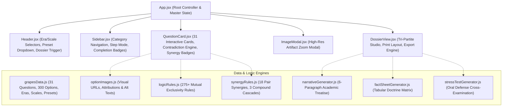

# G.R.A.P.E.S. Civilization Builder & Defense Simulator

[](https://grapes-civilization-builder.vercel.app)
[](https://github.com/DaemonAngelo17/grapes-civilization-builder)
[](https://react.dev/)
[](https://vitejs.dev/)
[](https://tailwindcss.com/)
[](https://www.socialstudies.org/standards/c3)

> An interactive digital humanities laboratory and pedagogical simulator modeling ancient world history through the **G.R.A.P.E.S.** framework (**G**eography, **R**eligion, **A**chievements, **P**olitics, **E**conomy, **S**ocial Structure). Students construct historically coherent civilizations across 31 fundamental inquiries and defend their societal doctrines against cross-examination by AI and teacher stress-testing.

---

## 🏛️ Table of Contents
1. [Pedagogical Thesis & Core Philosophy](#1-pedagogical-thesis--core-philosophy)
2. [Key Architectural Subsystems](#2-key-architectural-subsystems)
   - [2.1 Universal Multi-Choice Architecture (300 Options)](#21-universal-multi-choice-architecture-300-options)
   - [2.2 Chronological Eras & Spatial Civilization Scales](#22-chronological-eras--spatial-civilization-scales)
   - [2.3 Real-World Historical Inspirations (13 Spheres)](#23-real-world-historical-inspirations-13-spheres)
   - [2.4 Grade 7 Logic Guard (Contradiction Engine)](#24-grade-7-logic-guard-contradiction-engine)
   - [2.5 Two-Tiered Intelligent Synergy Engine](#25-two-tiered-intelligent-synergy-engine)
   - [2.6 Tri-Partite Imperial Dossier Studio](#26-tri-partite-imperial-dossier-studio)
3. [Exhaustive G.R.A.P.E.S. Inquiry Taxonomy](#3-exhaustive-grapes-inquiry-taxonomy)
4. [Teacher Stress-Test & Oral Defense Simulator](#4-teacher-stress-test--oral-defense-simulator)
5. [Archaeological Benchmark Presets](#5-archaeological-benchmark-presets)
6. [Component Hierarchy & Data Flow](#6-component-hierarchy--data-flow)
7. [Repository File Map](#7-repository-file-map)
8. [Installation & Local Development](#8-installation--local-development)
9. [Production Build & Deployment](#9-production-build--deployment)
10. [Academic References & Standards Alignment](#10-academic-references--standards-alignment)

---

## 1. Pedagogical Thesis & Core Philosophy

In traditional secondary history curricula, students often memorize disparate facts about ancient societies without internalizing the causal mechanisms governing historical development. The **G.R.A.P.E.S. Civilization Builder** treats world history as a dynamic, interconnected causal system:

```
[ GEOGRAPHY ] ──> Shapes ──> [ ECONOMY ] ──> Funds ──> [ POLITICS & MILITARY ]
      │                            │                           │
      ▼                            ▼                           ▼
Controls Natural             Dictates Surplus            Enforces Hierarchy
Disasters & Resources        & Trade Networks            & Border Defense
      │                            │                           │
      ▼                            ▼                           ▼
[ RELIGION ]  <── Rationalizes ── [ SOCIAL STRUCTURE ] ──> Builds ──> [ ACHIEVEMENTS ]
Cosmic Order & Divine Rule        Labor Pyramids & Rights              Monuments, Writing & Science
```

### Core Pedagogical Pillars:
- **Environmental Determinism vs. Human Agency:** Civilizations are anchored in their geographic constraints (e.g., lack of timber, flash floods, jagged topography) but innovate hydraulic, agricultural, or diplomatic adaptations to overcome them.
- **Universal Multi-Choice Freedom:** Rather than forcing arbitrary single-option selections, every question supports multi-choice selection—bounded only by **chronological validity**, **territorial land scale**, and **environmental possibility**.
- **Oral Defense Preparedness:** Students do not merely choose traits; they synthesize a comprehensive 6-paragraph historical treatise, review an executive fact sheet, and prepare responses to adversarial cross-examination questions in an authentic oral defense simulation.

---

## 2. Key Architectural Subsystems

### 2.1 Universal Multi-Choice Architecture (300 Options)
The application indexes **300 deeply researched options** across **31 inquiries** spanning all 6 G.R.A.P.E.S. categories. Each option includes:
- Authentic archaeological and historical descriptions drawn from primary civilizations across Africa, Eurasia, the Americas, and Oceania.
- High-resolution visual artifacts with attribution and interactive zoom modal inspection.
- Instant contextual logic evaluation preventing anachronisms or geographical impossibilities.

### 2.2 Chronological Eras & Spatial Civilization Scales

#### Five Historical Eras:
| Era ID | Historical Period | Chronology | Key Technological & Institutional Invariants |
|---|---|---|---|
| `early_bronze` | **Early Bronze Age** | c. 3500 – 2000 BCE | Copper/bronze metallurgy; weight-based silver rations; clay/papyrus scripts; **no iron, stamped coins, or alphabets**. |
| `late_bronze` | **Middle to Late Bronze Age** | c. 2000 – 1100 BCE | War chariot supremacy; diplomatic cuneiform archives; grand royal temples; early proto-alphabetic experimentation. |
| `early_iron` | **Early Iron Age** | c. 1100 – 500 BCE | Widespread iron metallurgy; 22-letter Phoenician phonetic alphabet; emergence of disciplined heavy infantry. |
| `classical_antiquity` | **Classical Antiquity** | c. 500 – 100 BCE | Stamped silver/bronze coinage; citizen assemblies and direct democracies; trireme naval combat; hoplite phalanxes. |
| `imperial_era` | **Imperial Classical Era** | c. 100 BCE – 500 CE | Trans-continental empires; pozzolanic underwater concrete; monumental aqueducts; stone frontier walls; compass navigation. |

#### Three Spatial Civilization Scales:
| Scale ID | Spatial Scale | Population | Geographic & Administrative Constraints |
|---|---|---|---|
| `city_state` | **Independent City-State** | 10k – 50k | Strictly confined to **1 local terrain** and **1 freshwater source**; maximum **1 natural barrier**; direct assembly democracy supported; grand continental bureaucracy prohibited. |
| `regional_kingdom` | **Regional Kingdom or League** | 100k – 1M | Spans up to **2 contiguous terrains**, **2 water sources**, and **2 natural barriers**; provincial administration and standing military forces supported. |
| `continental_empire` | **Grand Continental Empire** | Millions | Unbounded biomes; requires satrapy/provincial governors, royal courier roads, imperial bureaucracy, and standing multi-ethnic legions. |

### 2.3 Real-World Historical Inspirations (13 Spheres)
Students can align their civilization with 13 cultural and geopolitical spheres:
1. **Mesopotamia** (Sumer, Akkad, Babylon, Assyria)
2. **Ancient Egypt** (Old, Middle, New Kingdom)
3. **Indus Valley** (Harappa, Mohenjo-Daro, Lothal)
4. **Ancient China** (Shang, Zhou, Qin, Han Dynasties)
5. **Mesoamerica & Andes** (Maya, Aztec, Olmec, Zapotec, Inca, Tiwanaku)
6. **Classical Greece & Rome** (Polis, Republic, Imperium)
7. **Persian Empire** (Achaemenid & Sasanian)
8. **Phoenicia & Carthage** (Maritime Thalassocracy)
9. **Sub-Saharan African Kingdoms** (Kush, Aksum, Nok, Great Zimbabwe)
10. **Eurasian Steppe Confederations** (Scythians, Xiongnu, Royal Nomads)
11. **Austronesian & Polynesian Voyagers** (Lapita, Tonga, Rapa Nui, Hawaii)
12. **Pre-Columbian North America** (Mississippian Cahokia & Ancestral Puebloans)
13. **Custom / Synthetic Historical Hybrid**

### 2.4 Grade 7 Logic Guard (Contradiction Engine)
Located in `src/utils/logicRules.js`, the **Grade 7 Logic Guard** evaluates selections in real time across **over 275 mutual exclusivity invariants**:
- **Chronological Era Locks:** Automatically disables anachronisms (e.g., selecting stamped coins, iron weapons, or Roman concrete in the Early Bronze Age).
- **Scale-Based Geographic Locks:** Disables options exceeding the territorial bounds of a City-State or Regional Kingdom.
- **Natural Barrier Scale Limits:** Restricts defensive barriers based on territorial width (City-State: 1; Kingdom: 2; Empire: unlimited).
- **Island & Atoll Isolation Locks:** Excludes land-locked rivers, continental steppes, and land-bound cavalry on remote oceanic archipelagos.
- **Resource Abundance vs. Shortage Invariants:** Prevents simultaneously asserting a critical shortage and local abundance of timber, stone, tin, or fertile soil.
- **Cross-Category Institutional Clashes:** Ensures political systems, writing mediums, judicial codes, and religious rites remain causally consistent.

### 2.5 Two-Tiered Intelligent Synergy Engine
Located in `src/utils/synergyRules.js`, the synergy engine features:
- **Mandatory Synergies (🔒 Red Badge):** Enforces non-negotiable historical prerequisites (e.g., Selecting Hieroglyphs automatically mandates Papyrus or Carved Stone; choosing Quipu requires Incan knot-record keeping).
- **Recommended Synergies (💡 Gold Badge):** Guides students toward historically congruent complementary doctrines (e.g., Nile-style predictable flooding recommends Shadufs, Basin Irrigation, and Grain Granaries).
- **51 Single-Trigger Synergy Mappings:** Instantly connects foundational environmental or technological choices to downstream economic, political, and architectural outcomes.
- **3 Compound Multi-Trigger Cascades:**
  1. *Mesoamerican Sacrificial & Obsidian Complex:* Triggered by Bloodletting rituals + Obsidian weapons $\rightarrow$ Auto-recommends Ritual War Captives and Ballgame Athletics.
  2. *Continental Imperial Satrapy Administration:* Triggered by Imperial Scale + Royal Highways $\rightarrow$ Auto-recommends Kharosthi/Aramaic administrative cursive and Provincial Tribute.
  3. *Oceanic Wayfinding & High Island Agriculture:* Triggered by Polynesian Voyaging + Outrigger Canoes $\rightarrow$ Mandates Celestial Navigation and Master Shipwright guilds.

### 2.6 Tri-Partite Imperial Dossier Studio
Located in `src/components/DossierView.jsx`, the dossier compiles student selections into three distinct analytical instruments:
1. **Part I: Encyclopedia Narrative Essay:** A 6-paragraph scholarly historical narrative generated dynamically by `src/utils/narrativeGenerator.js`.
2. **Part II: Quick-Reference Fact Sheet Matrix:** A comprehensive tabular matrix generated by `src/utils/factSheetGenerator.js` displaying configured doctrines and custom notes across all 31 inquiries.
3. **Part III: Teacher Stress-Test Oral Defense Simulation:** Five customized adversarial cross-examination questions generated by `src/utils/stressTestGenerator.js`, complete with trigger mechanisms, professor angles, and bulleted defense strategies.

---

## 3. Exhaustive G.R.A.P.E.S. Inquiry Taxonomy

The system structures all historical knowledge into 31 inquiries across the 6 standard domains:

```
┌────────────────────────────────────────────────────────────────────────┐
│                      G.R.A.P.E.S. TAXONOMIC DOMAINS                    │
├───────────────────┬───────────────┬────────────────────────────────────┤
│ Category          │ Code & Range  │ Inquiries & Options                │
├───────────────────┼───────────────┼────────────────────────────────────┤
│ Geography (G)     │ G1 – G6       │ 6 Inquiries  | 64 Total Options    │
│ Economy (E)       │ E1 – E5       │ 5 Inquiries  | 47 Total Options    │
│ Politics (P)      │ P1 – P5       │ 5 Inquiries  | 50 Total Options    │
│ Social Structure  │ S1 – S5       │ 5 Inquiries  | 40 Total Options    │
│ Religion (R)      │ R1 – R5       │ 5 Inquiries  | 44 Total Options    │
│ Achievements (A)  │ A1 – A5       │ 5 Inquiries  | 55 Total Options    │
├───────────────────┴───────────────┼────────────────────────────────────┤
│ TOTAL MASTER TAXONOMY             │ 31 Inquiries | 300 Validated Items │
└───────────────────────────────────┴────────────────────────────────────┘
```

### Complete Breakdown of Inquiries:
- **Geography (G1–G6):**
  - `G1` (`g2_terrain`): Dominant Terrain & Topography (11 options)
  - `G2` (`g1_freshwater`): Primary Freshwater Source (11 options)
  - `G3` (`g3_barriers`): Natural Defensive Barriers (10 options)
  - `G4` (`g4_resources`): Abundant Natural Resources (13 options)
  - `G5` (`g5_shortages`): Critical Resource Shortages (9 options)
  - `G6` (`g6_disasters`): Recurring Environmental Disasters (10 options)
- **Economy (E1–E5):**
  - `E1` (`e1_crops`): Staple Agricultural Crops (10 options)
  - `E2` (`e2_animals`): Domesticated Animals (11 options)
  - `E3` (`e5_trade`): Trade Networks & Exports (8 options)
  - `E4` (`e3_currency`): Medium of Exchange / Currency (10 options)
  - `E5` (`e4_taxation`): Primary Method of Taxation (8 options)
- **Politics & Military (P1–P5):**
  - `P1` (`p1_gov_system`): System of Government (11 options)
  - `P2` (`p2_succession`): Succession & Transfer of Power (9 options)
  - `P3` (`p3_law_system`): Legal Code & Justice System (10 options)
  - `P4` (`p4_military`): Military Organization & Doctrines (12 options)
  - `P5` (`p5_foreign_policy`): Foreign Policy & Treatment of Conquered Peoples (8 options)
- **Social Structure (S1–S5):**
  - `S1` (`s1_apex`): The Ruling Apex (8 options)
  - `S2` (`s2_middle`): The Middle Class & Specialized Artisans (9 options)
  - `S3` (`s3_mobility`): Social Mobility (8 options)
  - `S4` (`s4_gender`): Gender Roles & Legal Status of Women (7 options)
  - `S5` (`s5_unfree_labor`): The Bottom Tier & Unfree Labor (8 options)
- **Religion (R1–R5):**
  - `R1` (`r1_structure`): Structure of the Divine (9 options)
  - `R2` (`r2_demeanor`): Demeanor of the Gods (8 options)
  - `R3` (`r3_rituals`): Primary Religious Rituals & Practices (10 options)
  - `R4` (`r4_afterlife`): Death, Burial, and the Afterlife (10 options)
  - `R5` (`r5_gov_relation`): Relationship Between Religion and Government (7 options)
- **Achievements & Engineering (A1–A5):**
  - `A1` (`a4_hydraulic`): Agricultural & Hydraulic Engineering (9 options)
  - `A2` (`a1_writing`): Writing System & Script (12 options)
  - `A3` (`a2_medium`): Primary Writing Medium (9 options)
  - `A4` (`a3_monuments`): Monumental Architecture (12 options)
  - `A5` (`a5_science`): Scientific, Mathematical & Technological Breakthroughs (13 options)

---

## 4. Teacher Stress-Test & Oral Defense Simulator

The **Teacher Stress-Test Generator** (`src/utils/stressTestGenerator.js`) scans the student's choices for institutional tensions, environmental hypocrisies, and strategic vulnerabilities. It formulates rigorous questions simulating an oral thesis examination.

### Example Cross-Examination Scenarios:

#### Scenario 1: Open Plains vs. Peasant Levy
- **Trigger:** Flat open alluvial plains (`G1`/`G3`) + Seasonal peasant levy (`P4`)
- **Question:** *"Your territory consists of wide-open, flat alluvial plains with zero natural defensive barriers, yet your military relies upon a seasonal peasant levy that only mobilizes after harvest. If a hostile neighbor launches a surprise cavalry raid in mid-summer while your crops are still in the ground, how do you prevent your entire agrarian economy and undefended cities from being razed before your peasant army can even be mustered?"*
- **Professor's Angle:** Testing vulnerability to pre-harvest blitzkrieg and the strategic contradiction between agrarian labor cycles and border defense.
- **Recommended Defense:** Highlight early warning beacon towers, fortified municipal granaries where rural populations take refuge, and local standing border garrisons.

#### Scenario 2: Timber Shortage vs. Naval Hegemony
- **Trigger:** Critical timber shortage (`G5`) + Naval supremacy (`P4`) / Maritime trade (`E3`)
- **Question:** *"Your civilization champions naval supremacy with trireme combat fleets and grand architecture, yet your geography suffers from a critical shortage of tall timber. How do you maintain, repair, and expand a state navy when every beam of cedar or oak must be purchased abroad? What prevents an opposing maritime power from implementing a naval blockade on your timber supply lines and starving your shipyards?"*
- **Professor's Angle:** Testing supply chain vulnerabilities and foreign dependency on strategic military materials.
- **Recommended Defense:** Cite bilateral concession treaties with timber-rich mountain vassals (analogous to Egypt's Phoenician cedar trade) and state ship timber reclamation policies.

#### Scenario 3: Theocratic God-King vs. Unpredictable Cataclysms
- **Trigger:** Theocratic God-King / Mandate of Heaven (`R1`/`P2`) + Flash floods / Severe droughts (`G6`)
- **Question:** *"Your political legitimacy hinges on a Theocratic God-King or celestial Mandate of Heaven, yet your land is repeatedly afflicted by catastrophic droughts or unannounced flash floods. When the rivers fail or wash away whole districts and thousands face famine, how does the royal court prevent the priesthood and restless subjects from claiming the ruler has lost divine favor and staging a holy coup d'état?"*
- **Professor's Angle:** Testing ideological stability when environmental realities contradict claims of cosmic harmony.
- **Recommended Defense:** State dogma attributes ecological disasters to cosmic trials or communal moral impurities requiring state-led purification rituals rather than monarchical illegitimacy.

---

## 5. Archaeological Benchmark Presets

The simulator includes four fully configured historical benchmarks demonstrating 100% logical cohesion:

```
┌────────────────────────────────────────────────────────────────────────┐
│                     ARCHAEOLOGICAL BENCHMARK PRESETS                   │
├─────────────┬────────────────────────────────────┬─────────────────────┤
│ Preset ID   │ Civilization & Realm               │ Key Historical Era  │
├─────────────┼────────────────────────────────────┼─────────────────────┤
│ egypt       │ Kemet (The Black Land of the Nile) │ Early Bronze Age    │
│ mesopotamia │ Sumer & Babylon (Fertile Crescent) │ Early Bronze Age    │
│ maya        │ Tikal & Copan (Jade Jaguar Realm)  │ Classical Antiquity │
│ greece_rome │ Classical Polis League (Hellas)    │ Classical Antiquity │
└─────────────┴────────────────────────────────────┴─────────────────────┘
```

1. **Ancient Egypt (`egypt`):**
   - *Era & Scale:* Early Bronze Age | Regional Kingdom
   - *Geography:* Alluvial river floodplain, annual predictable flooding, surrounding desert barriers, abundant limestone and gold, missing timber.
   - *Institutions:* Theocratic Pharaoh god-king, corvée labor during inundation, hieroglyphic script on papyrus, stone pyramids and hypostyle halls.
2. **Mesopotamia (`mesopotamia`):**
   - *Era & Scale:* Early Bronze Age | Independent City-State
   - *Geography:* Flat alluvial plain between Tigris and Euphrates, violent unpredictable floods, open unprotected borders, rich clay/bitumen, missing stone and metal ores.
   - *Institutions:* Cuneiform on baked clay tablets, Hammurabi-style lex talionis, mudbrick ziggurats, professional bronze spearmen phalanxes.
3. **Classic Maya (`maya`):**
   - *Era & Scale:* Classical Antiquity | Independent City-State
   - *Geography:* Karst limestone plateau with underground cenotes, dense tropical rainforest, seasonal tropical deluges and karst droughts.
   - *Institutions:* Divine Ahau divine kingship, jade/cacao bean currency, glyphic bark-paper codices, stepped limestone pyramids, ritual ballgame athletics.
4. **Classical Greece & Rome (`greece_rome`):**
   - *Era & Scale:* Classical Antiquity | Independent City-State
   - *Geography:* Jagged mountain valleys, island archipelagos, Mediterranean sea lanes, abundant marble/silver, critical grain deficits.
   - *Institutions:* Direct citizen assembly democracy, silver drachma coinage, citizen hoplite phalanxes, phonetic alphabet on wax/parchment, columned marble temples.

---

## 6. Component Hierarchy & Data Flow



---

## 7. Repository File Map

```
grapes-civilization-builder/
├── public/                       # Static public assets
├── src/
│   ├── components/
│   │   ├── DossierView.jsx       # Tri-Partite Imperial Dossier Modal (Narrative, Fact Sheet, Defense)
│   │   ├── Header.jsx            # Top app bar, presets, scale/era pickers, build progress
│   │   ├── ImageModal.jsx        # Full-screen historical artifact inspection modal
│   │   ├── QuestionCard.jsx      # Multi-choice question component with logic locks & badges
│   │   └── Sidebar.jsx           # Vertical category navigation & completion indicators
│   ├── data/
│   │   ├── grapesData.js         # Master data: Categories, 31 Questions, 300 Options, Eras, Scales
│   │   └── optionImages.js       # Curated high-resolution image URLs and captions for 300 options
│   ├── utils/
│   │   ├── factSheetGenerator.js # Generates 31-row comparative table matrix for oral defense
│   │   ├── logicRules.js         # 275+ mutual exclusivity rules, era locks, and scale invariants
│   │   ├── narrativeGenerator.js # Synthesizes 6-paragraph historical narrative essay
│   │   ├── stressTestGenerator.js# Formulates teacher cross-examination defense questions
│   │   └── synergyRules.js       # 2-tiered synergy engine (51 single-trigger + 3 compound cascades)
│   ├── App.jsx                   # Master application controller, state management, toast handler
│   ├── index.css                 # Classical parchment design system & Tailwind CSS v4 styling
│   └── main.jsx                  # React 19 application entry point
├── dist/                         # Optimized production build artifacts
├── GRAPES_SYSTEM_SPECIFICATION.md# Exhaustive 1,076-line data dictionary & academic specification
├── GRAPES_SIMULATOR_TECHNICAL_INSPECTION_REPORT.md # Companion technical audit & code analysis
├── index.html                    # Root HTML document with Cinzel & Cormorant Garamond typography
├── package.json                  # Dependencies: React 19, Lucide React, Tailwind CSS v4, Vite 8
├── vite.config.js                # Vite build pipeline with Tailwind CSS v4 plugin
└── README.md                     # Master project documentation
```

---

## 8. Installation & Local Development

### Prerequisites:
- **Node.js:** v18.0.0 or higher (v20+ recommended)
- **Package Manager:** npm or yarn

### Quickstart:

```bash
# 1. Clone repository
git clone https://github.com/DaemonAngelo17/grapes-civilization-builder.git
cd grapes-civilization-builder

# 2. Install dependencies
npm install

# 3. Launch local development server
npm run dev
```

The application will launch locally at `http://localhost:5188` (or the next available port).

---

## 9. Production Build & Deployment

### Build Command:
```bash
npm run build
```
The optimized bundle will be generated in `dist/`:
- `dist/index.html` (~1.1 kB)
- `dist/assets/index-[hash].css` (~46 kB)
- `dist/assets/index-[hash].js` (~643 kB minified)

### Vercel Deployment:
The project is pre-configured for zero-configuration continuous deployment on Vercel:
- **Framework Preset:** Vite
- **Build Command:** `npm run build`
- **Output Directory:** `dist`
- **Production URL:** [https://grapes-civilization-builder.vercel.app](https://grapes-civilization-builder.vercel.app)

---

## 10. Academic References & Standards Alignment

- **National Council for the Social Studies (NCSS):** C3 Framework for Social Studies State Standards (Dimension 2: Applying Disciplinary Tools and Concepts in History & Geography).
- **California History-Social Science Framework (Grade 7):** World History and Geography: Medieval and Early Modern Times.
- **Diamond, Jared (1997):** *Guns, Germs, and Steel: The Fates of Human Societies*. W. W. Norton & Company.
- **Trigger, Bruce G. (2003):** *Understanding Early Civilizations: A Comparative Study*. Cambridge University Press.
- **Scott, James C. (2017):** *Against the Grain: A Deep History of the Earliest States*. Yale University Press.

---

**Author:** Ezra Joseph Saracho ([@DaemonAngelo17](https://github.com/DaemonAngelo17))  
**License:** MIT License  
**Academic Inquiries:** Digital Humanities & Ancient World History Education Lab
